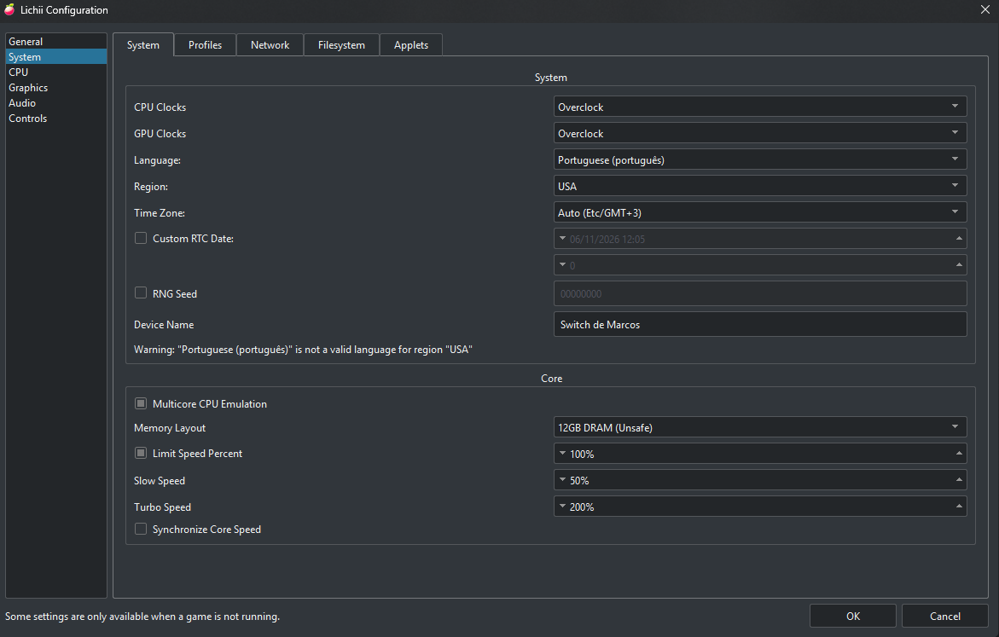
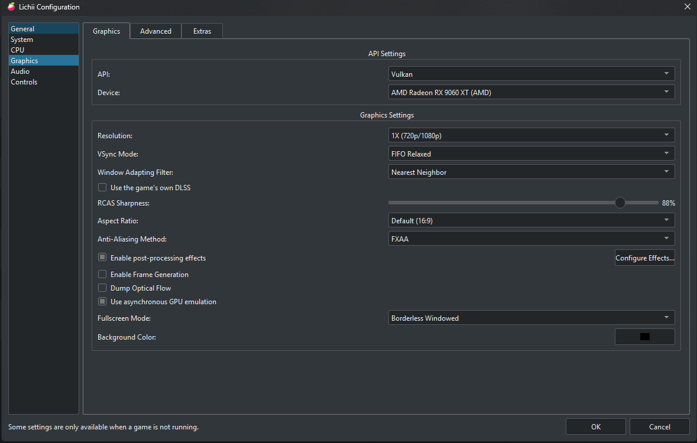
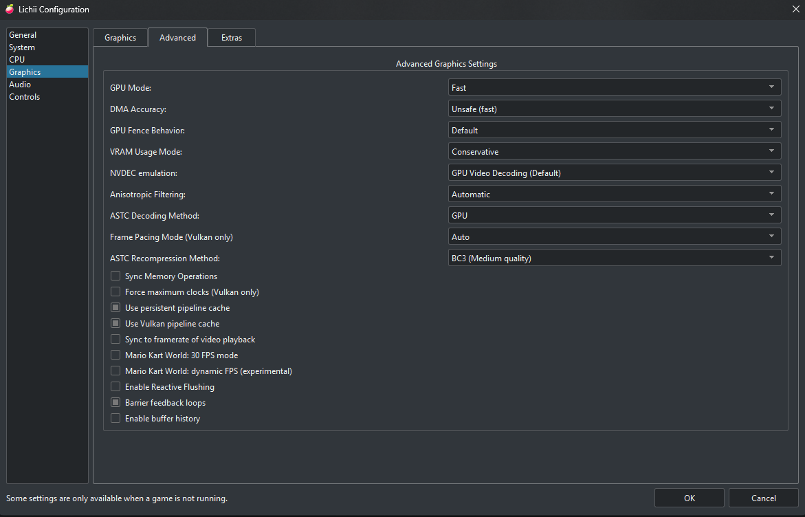
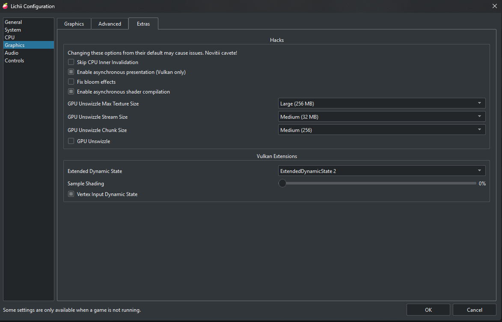

# <p align="center"></p>

<h1 align="center">Lichii - Fork MDias v4 (AMD Radeon Edition)</h1>

<p align="center">
  <b>Compilação especializada de alta performance para GPUs AMD Radeon, com foco especial em <i>The Legend of Zelda: Ocarina of Time</i> e emulação avançada de Nintendo Switch 2.</b>
</p>

<p align="center">
  
  
  
  
</p>

---

## 🌟 Sobre o Projeto

Esta é uma compilação personalizada de alto desempenho desenvolvida por **Marcos Dias (MDias)**, baseada no trabalho de *sharkiix* e *chuppatricky*. O projeto traz otimizações profundas no renderizador **Vulkan**, suporte integral e nativo em **Português Brasileiro (PT-BR)**, e gerenciamento refinado de shaders e memória de textura para arquiteturas **AMD RDNA 2, RDNA 3 e RDNA 4** (séries RX 6000, 7000 e 9000).

---

## 🚀 Principais Recursos e Novidades da Versão v4

### 1. Interface 100% em Português Brasileiro (PT-BR)
- Menus (**Arquivo**, **Emulação**, **Exibir**, **Ferramentas**, **Ajuda**), janelas de configurações, caixas de diálogo, notificações e atalhos traduzidos nativamente.
- O menu **Ajuda > Sobre Lichii** exibe agora a identificação oficial do **Fork MDias v4**, com informações detalhadas da compilação e créditos aos projetos base.

### 2. Cache de Shaders Compartilhado (Shared Shader Cache)
- Se outro jogador disponibilizar seu cache compilado, você não precisará mais compilar os mesmos shaders do zero, eliminando micro-travamentos (*stutters*) ao explorar novos cenários e masmorras.
- O arquivo pode ser nomeado (ex: `vulkan-amigo.bin`), desde que inicie com `vulkan` e termine com `.bin`.
- Basta posicioná-lo na pasta de cache de shaders do jogo em `%APPDATA%\eden\cache\shader\0400486024dec000\`. No boot, o emulador mescla os shaders automaticamente ao seu cache permanente.

### 3. Opção de Bloqueio em 30 FPS Perfeito
- Suporte a trava estável em 30 FPS via flag `EDEN_NX2_SWAP_INTERVAL=2` no arquivo `nx2_switches.txt`, ideal para taxas de quadros 100% homogêneas e ritmo consistente.

### 4. Dynamic FPS Nativo Integrado
- Patch de FPS dinâmico incorporado diretamente ao núcleo do emulador, eliminando a necessidade de mods externos. A velocidade do jogo permanece correta mesmo com oscilação na taxa de quadros.

### 5. Renderização e Otimização para GPUs AMD Radeon
- **Emulação Acelerada de Tensores:** Ganhos expressivos na taxa de quadros (telas de título subindo de ~15 para 50-60 FPS).
- **Correção Visual de Névoa e Iluminação:** Tratamento calibrado de neblina e luz, eliminando a película translúcida excessiva e o tom azulado/esverdeado das versões anteriores.
- **Cache de Texturas para Placas de 12 GB+:** Ganho expressivo de fluidez em locais densos (ex: Kokiri Village em GPUs como RX 9060 XT 16 GB saltando de 35 para mais de 43 FPS sem perda de qualidade).
- **Proteção Ativa Contra Queda de Driver ("Device loss occurred"):** Resolução de loops de shaders complexos na inicialização de gameplay nas GPUs RX 9070 XT, RX 9060 XT e RX 7800 XT.

---

## 🖼️ Capturas de Tela

<p align="center">
  
  
</p>
<p align="center">
  
  
</p>

---

## ⚙️ Configurações Recomendadas no `nx2_switches.txt`

O arquivo `nx2_switches.txt` acompanha o executável e aceita as seguintes diretivas principais:

```ini
# Descarrega comandos/macros de GPU para thread secundária (+54% FPS)
EDEN_NX2_SPLIT=2

# Agrupamento de cercas de sincronização da GPU (redução de overhead no driver)
EDEN_NX2_FENCE_BATCH=1

# Correção visual de neblina para Ocarina of Time (reduced, on, off ou original)
EDEN_NX2_OOT_FOG=reduced

# Pré-compilação antecipada de pipelines de shaders no boot
EDEN_NX2_PRELOAD_ALL_PIPELINES=1

# Opcional: Trava em 30 FPS estável (descomente removendo o # se desejar)
#EDEN_NX2_SWAP_INTERVAL=2
```

---

## 📁 Estrutura de Pastas

```
├── Emulador/                      # Diretório de distribuição do emulador pronto para uso
│   ├── lichii.exe                 # Executável do emulador (Fork MDias v4, PT-BR)
│   ├── dxcompiler.dll             # Compilador DirectX / HLSL para Vulkan
│   ├── dxil.dll                   # Biblioteca auxiliar de validação DXIL
│   ├── nx2_switches.txt           # Ajustes de performance e compatibilidade
│   ├── LEIA-ME.txt                # Instruções rápidas de uso em português
│   └── languages/                 # Módulos de tradução compilados
│       ├── pt_BR.qm               # Tradução ativa em Português Brasileiro
│       └── en.qm, default.qm...   # Cópias de segurança para garantia de idioma
├── Projeto/                       # Código-fonte completo e recursos do projeto
│   ├── src/                       # Código-fonte em C++
│   ├── dist/                      # Arquivos de distribuição, temas e traduções
│   ├── imgs/                      # Logo oficial e capturas de tela
│   ├── CMakeLists.txt             # Script de compilação CMake
│   ├── MDIAS.md                   # Registro de alterações e notas do Fork MDias
│   └── README.md                  # Documentação principal do projeto
```

---

## ⚖️ Licença e Avisos Legais

Distribuído sob a licença **GPL-3.0-or-later**. O código-fonte integral está incluído neste repositório.

> **Aviso:** Nintendo Switch e Nintendo Switch 2 são marcas registradas da Nintendo Co., Ltd. Este projeto é de código aberto para fins educacionais e de pesquisa e não possui vínculo com a Nintendo.
