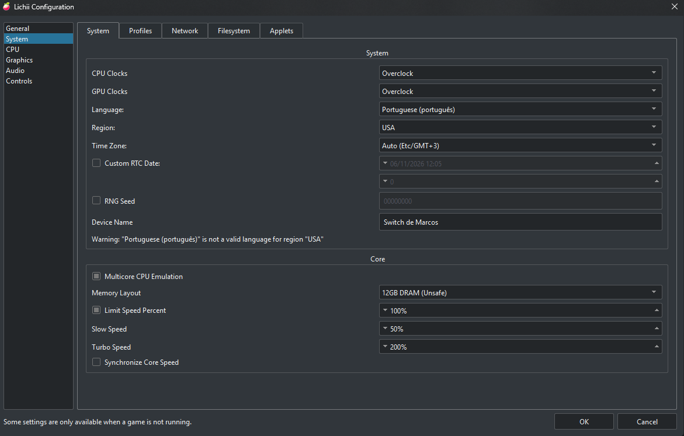
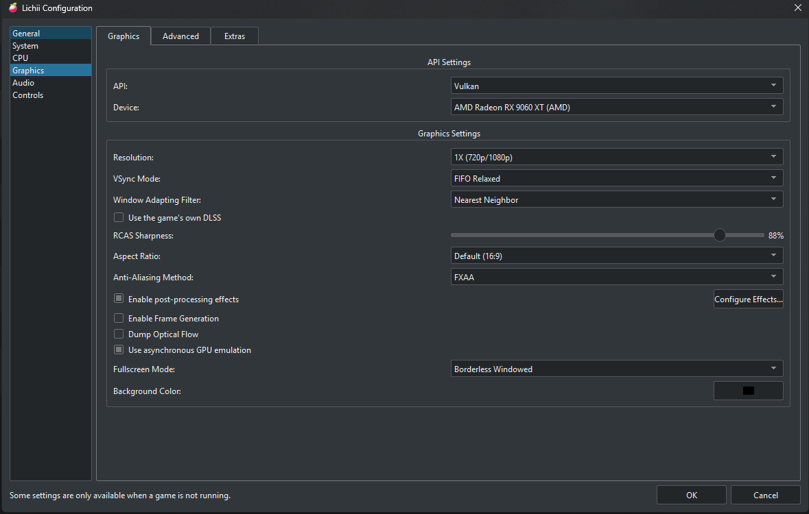
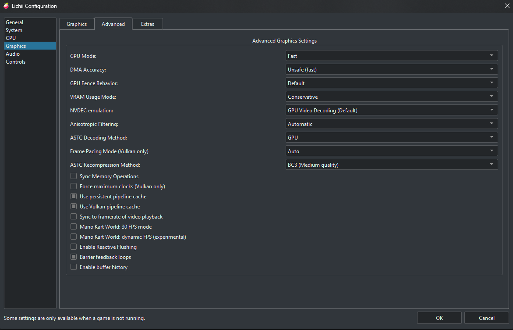
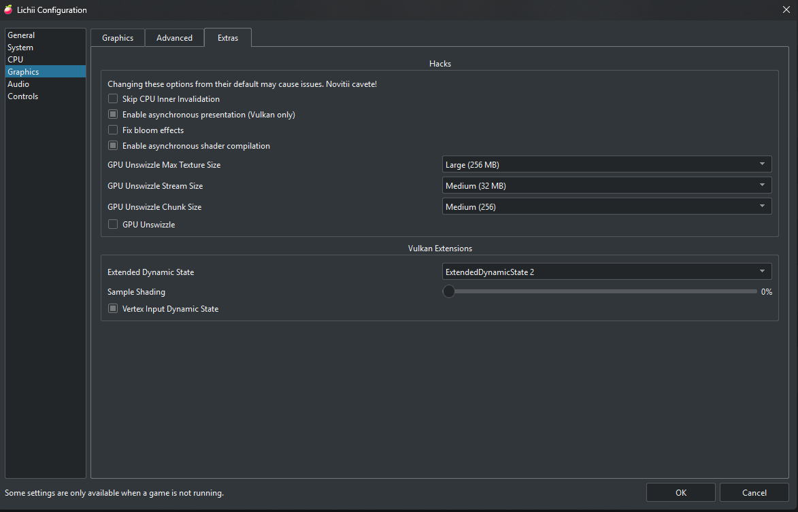

<!--
# SPDX-FileCopyrightText: Copyright 2026 Marcos Dias (MDias)
# SPDX-License-Identifier: GPL-3.0-or-later
-->

  

# Lichii — fork MDias v3 (AMD Edition)

O **Lichii fork MDias v3** é uma versão experimental e de alta performance do emulador de Nintendo Switch e Switch 2, desenvolvida por **Marcos Dias (MDias)**. Esta versão traz como grande diferencial a **tradução completa da interface para Português Brasileiro (PT-BR)**, renderizador Vulkan altamente otimizado para placas de vídeo **AMD Radeon**, mitigação de stuttering de compilação de shaders e correções visuais e de estabilidade para títulos como *The Legend of Zelda: Ocarina of Time* e outros jogos de Switch 2.

---

## 💻 Especificações da Máquina de Testes e Validação

Todas as otimizações, calibrações de cores, taxas de quadros e perfis de shaders da versão **fork MDias v3** foram desenvolvidos e validados no seguinte hardware:

- **Placa-Mãe:** B550M AORUS ELITE
- **Placa de Vídeo:** Gigabyte AMD Radeon RX 9060 XT 16 GB
- **Memória RAM:** 16 GB DDR4 HyperX Fury
- **Armazenamento:** NVME 1 TB

---

## ⚙️ Configurações Sugeridas

Para obter o melhor equilíbrio entre estabilidade, fidelidade gráfica e taxa de quadros (FPS) em placas AMD Radeon, utilize as configurações recomendadas a seguir.

### 1. Sistema (System)

  

- **CPU Clocks:** `Overclock` — Remove limitadores artificiais de FPS impostos por alguns títulos.
- **GPU Clocks:** `Overclock` — Mantém a GPU em alta fidelidade evitando que o jogo reduza render distance dinamicamente.
- **Language / Idioma:** `Portuguese (português)` — Idioma do sistema emulado em Português.
- **Region / Região:** `USA`
- **Time Zone / Fuso Horário:** `Auto (Etc/GMT+3)` — Horário de Brasília / Brasil.
- **Device Name:** `Switch de Marcos`
- **Memory Layout (Core):** `12GB DRAM (Unsafe)` — Expande a memória disponível para emulação de jogos pesados e Switch 2.
- **Limit Speed Percent:** `100%` (Desmarcado para liberar taxa de quadros ou marcado para trava em velocidade nativa).
- **Turbo Speed:** `200%` / **Slow Speed:** `50%`.

---

### 2. Gráficos (Graphics)

  

- **API:** `Vulkan` (Essencial para desempenho ideal e estabilidade em drivers AMD).
- **Dispositivo (Device):** `AMD Radeon RX 9060 XT (AMD)`
- **Resolução:** `1X (720p/1080p)`
- **Modo VSync:** `FIFO Relaxed` (Elimina tearing mantendo frametimes homogêneos).
- **Filtro de Adaptação de Janela:** `Nearest Neighbor`
- **Nitidez RCAS:** `88%` (Proporciona nitidez cristalina sem artefatos visuais).
- **Proporção de Tela (Aspect Ratio):** `Padrão (16:9)`
- **Método Anti-Aliasing:** `FXAA`
- **Modo Tela Cheia:** `Borderless Windowed` (Janela Sem Bordas)
- **Cor de Fundo:** Preto

---

### 3. Gráficos Avançados (Advanced Graphics)

  

- **Modo da GPU (GPU Mode):** `Fast` (Rápido)
- **Precisão de DMA (DMA Accuracy):** `Unsafe (fast)` — Reduz a latência de transferência de texturas na GPU.
- **Comportamento de Fence da GPU:** `Default`
- **Modo de Uso de VRAM:** `Conservative`
- **Emulação NVDEC:** `GPU Video Decoding (Default)` — Decodificação de vídeos via aceleração gráfica.
- **Filtro Anisotrópico:** `Automatic`
- **Método de Decodificação ASTC:** `GPU` (Decodificação direta pelos Compute Units da Radeon).
- **Frame Pacing Mode (Vulkan):** `Auto`
- **Método de Recompressão ASTC:** `BC3 (Medium quality)` — Economiza VRAM sem perda perceptível de qualidade.
- **Caches de Pipeline:** Ativados para persistência contínua entre sessões.

---

### 4. Extras e Hacks de Gráficos (Extras)

  

- **Hacks:**
  - `GPU Unswizzle Max Texture Size`: `Large (256 MB)`
  - `GPU Unswizzle Stream Size`: `Medium (32 MB)`
  - `GPU Unswizzle Chunk Size`: `Medium (256)`
- **Extensões Vulkan:**
  - `Extended Dynamic State`: `ExtendedDynamicState 2`
  - `Sample Shading`: `0%`

---

## 🚀 Como Executar o Emulador

1. Acesse a pasta do executável compilado: `Emulador/` (ou `C:\Users\mppdi\Desktop\Emulador`).
2. Execute o aplicativo principal **`lichii.exe`**.
3. O emulador iniciará automaticamente em **Português Brasileiro (PT-BR)** com a identificação **fork MDias v3**.
4. Para ajustes finos de desempenho em jogos específicos (como névoa, batches de fences e pre-load de pipelines), consulte ou edite o arquivo **`nx2_switches.txt`** na mesma pasta do executável.

> [!TIP]
> No arquivo `nx2_switches.txt`, os parâmetros `EDEN_NX2_SPLIT=2`, `EDEN_NX2_FENCE_BATCH=1` e `EDEN_NX2_OOT_FOG=reduced` já vêm pré-configurados para a melhor experiência na RX 9060 XT.

---

## 🌟 Principais Recursos do Fork MDias v3

- **Interface Totalmente em Português Brasileiro (PT-BR):** Menus, caixas de diálogo, ferramentas, atalhos e avisos traduzidos.
- **Patch de Dynamic FPS Integrado:** O emulador gerencia a taxa de quadros e o tempo de jogo dinamicamente, mantendo a física normal sem necessidade de mods externos.
- **Cache de Shaders Persistente:** Preservação de pipelines gráficos entre sessões, eliminando engasgos ao explorar novas áreas.
- **Otimização de Tensores e Shaders em AMD:** Melhora substancial de fluidez na renderização Vulkan.
- **Correção Visual de Neblina e Cores:** Eliminação da névoa excessiva e ajuste de iluminação em jogos de Switch 2.
- **Estabilidade Reforçada:** Prevenção de perda de dispositivo Vulkan ("Device loss occurred") em placas Radeon.

---

## 📜 Licença e Créditos

Este projeto é desenvolvido e mantido por **Marcos Dias (MDias)** como um fork independente, livre e de código aberto sob a licença **GPL-3.0-or-later**. Preserva e respeita o histórico de contribuições dos projetos de emulação de código aberto upstream (Eglantine, Eden, yuzu, Sudachi).

O código-fonte completo está disponível na pasta do projeto.
